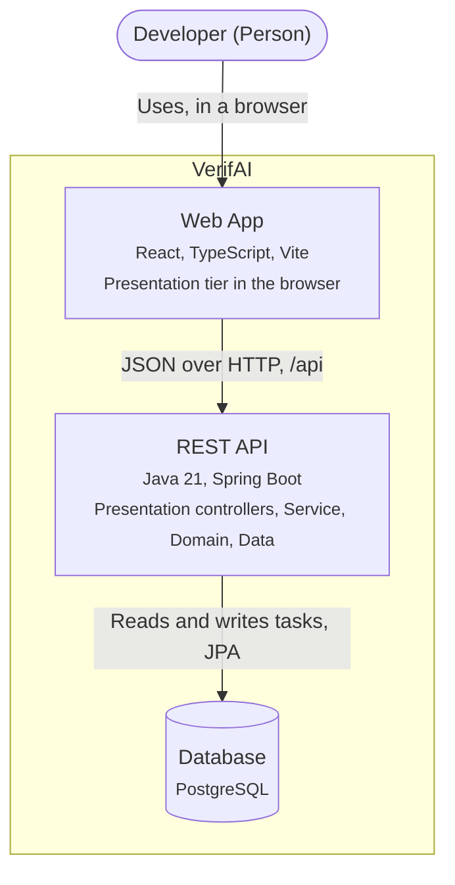
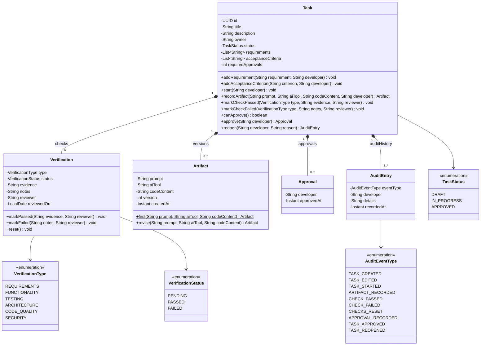
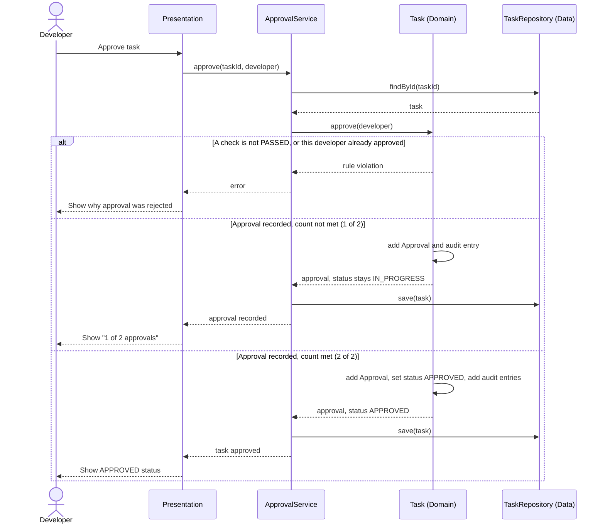

# VerifAI: AI Code Verification & Accountability Manager


**Student:** Alejandro Santana · **Course:** CEN 5064 Software Design, Fall 2026 · **Peer reviewer:** [@dquin144]

## Project Description

AI coding assistants allow developers to produce software faster, but they also create a growing need to verify that AI-generated code actually satisfies its requirements, passes appropriate tests, and fits the architecture of the project. VerifAI is a lightweight system designed for software developers who use AI coding assistants and want a structured way to verify and document their AI-assisted work before it is committed. The system will allow developers to define development tasks and acceptance criteria, record AI-generated code and its associated prompts, perform and track verification checks such as requirements, testing, architecture, and security reviews, and maintain an auditable history of verification results and human approval. The goal is to provide developers with a repeatable workflow for moving AI-generated code from generation → verification → correction → approval, while maintaining human accountability for the final implementation.

**Core Features**
- <ins>Task & Specification Management</ins>: Create development tasks with descriptions, requirements, and acceptance criteria that define what the implementation must accomplish.
- <ins>AI Artifact Tracking</ins>: Record AI-generated code, prompts, AI tools, and implementation versions associated with each development task.
- <ins>Verification & Testing</ins>: Track verification checks covering requirements, functionality, testing, architecture, code quality, and security, including the results of automated tests where applicable.
- <ins>Review & Accountability</ins>: Manage the approval workflow and maintain a history of verification results and revisions. A task cannot be approved unless every required verification check has been individually marked as **PASSED** and at least two different developers have approved it, ensuring that approval represents a completed verification process rather than simply a recorded status.

## How to run

Prerequisites: Git, JDK 21, Maven 3.9 or newer, and Node.js 24 (which includes npm), all on your `PATH`. There is no Maven wrapper. Check them first:

```
java -version
mvn -v
node -v
npm -v
```

`java -version` should report version 21, `mvn -v` should report Java version 21, and `node -v` should report `v24` (24.15 or newer).

The app runs in two terminals: the backend API on port 8080 and the frontend dev server on port 5173. The frontend sends every `/api` request to the backend, so start both.

**Terminal 1, the backend.** Build, test, and start it from a fresh clone. These commands work in PowerShell and in bash:

```
git clone https://github.com/ASantana0924/cen5064-project-santana.git
cd cen5064-project-santana
mvn verify
mvn spring-boot:run "-Dspring-boot.run.profiles=demo"
```

- `mvn verify` should end with `BUILD SUCCESS` and `Failures: 0, Errors: 0`.
- `mvn spring-boot:run` keeps running and should log `Tomcat started on port 8080`.
- The `demo` profile adds four sample tasks, one at each stage of the workflow. Keep the quotes; PowerShell needs them. To start with no tasks, run `mvn spring-boot:run` instead.

**Terminal 2, the frontend.** Open a second terminal in the same `cen5064-project-santana` folder:

```
cd frontend
npm ci
npm run dev
```

- `npm ci` installs the exact versions in `package-lock.json`. It is needed only after a fresh clone or when `package-lock.json` changes.
- `npm run dev` keeps running and prints `Local: http://localhost:5173/`.

Open http://localhost:5173 in a browser. With the `demo` profile you should see four tasks: two Draft, one In progress, and one Approved. Choose your name with the button at the top right; it is saved in the browser and used as the owner of tasks you create. Select **New task** to create one, or select a task to see its details.

Tasks are kept in memory and are lost when the backend stops. Press `Ctrl+C` in each terminal to stop the app.

To run the frontend checks that CI runs, from the `frontend` folder:

```
npm run lint
npm run build
npm test
```

Each should finish without errors, and `npm test` should report every test as passed.

### Try the API

You can also call the API directly. Open another PowerShell window while the backend is running. List the tasks:

```powershell
Invoke-RestMethod http://localhost:8080/api/tasks | Format-Table title, owner, status, passedChecks, approvalCount
```

With the `demo` profile you should see four rows: two DRAFT, one IN_PROGRESS with 3 passed checks, and one APPROVED with 2 approvals. Without it the list is empty.

Create a task, add a requirement and an acceptance criterion, and start it:

```powershell
$api = "http://localhost:8080/api/tasks"
$task = Invoke-RestMethod -Method Post -Uri $api -ContentType "application/json" -Body '{"title":"Add login check","description":"Reject blank usernames","developer":"alex"}'
Invoke-RestMethod -Method Post -Uri "$api/$($task.id)/requirements" -ContentType "application/json" -Body '{"text":"Blank usernames are rejected","developer":"alex"}' | Out-Null
Invoke-RestMethod -Method Post -Uri "$api/$($task.id)/acceptance-criteria" -ContentType "application/json" -Body '{"text":"A blank username shows an error","developer":"alex"}' | Out-Null
Invoke-RestMethod -Method Post -Uri "$api/$($task.id)/start" -ContentType "application/json" -Body '{"developer":"alex"}' | Select-Object title, status, canStart
```

The last command should print `status` as `IN_PROGRESS` and `canStart` as `False`.

Endpoints:

| Method | Path | Body or query | Does |
|---|---|---|---|
| POST | `/api/tasks` | `{title, description, developer}` | Creates a DRAFT task owned by `developer`. Returns 201 and a `Location` header. |
| GET | `/api/tasks` | | Lists task summaries, oldest first. |
| GET | `/api/tasks/{id}` | | Returns full details and the `editable`, `canStart`, and `canApprove` flags. |
| PATCH | `/api/tasks/{id}` | `{title, description, developer}` | Edits the title and description. |
| POST | `/api/tasks/{id}/requirements` | `{text, developer}` | Adds a requirement. |
| DELETE | `/api/tasks/{id}/requirements/{index}` | `?developer=alex` | Removes the requirement at a 0-based position. |
| POST | `/api/tasks/{id}/acceptance-criteria` | `{text, developer}` | Adds an acceptance criterion. |
| DELETE | `/api/tasks/{id}/acceptance-criteria/{index}` | `?developer=alex` | Removes the criterion at a 0-based position. |
| POST | `/api/tasks/{id}/start` | `{developer}` | Starts a DRAFT task. |

Every action names the acting `developer`; there is no login ([ADR-005](docs/adr/adr-005.md)). Errors are JSON `{status, error, message}`: 400 for invalid input, 404 for an unknown task, and 409 when a rule blocks the action.

These steps change as the project grows: #53 adds artifacts, checks, approvals, and audit history to the API, #56 to #58 add the rest of the frontend, and #59 adds PostgreSQL.

## Rules

These rules live in the Domain tier and are recorded in [ADR-004](docs/adr/adr-004.md).

1. **Statuses.** A task is DRAFT, IN_PROGRESS, or APPROVED. A verification check is PENDING, PASSED, or FAILED.
2. **Six required checks.** Every task has one check of each type: REQUIREMENTS, FUNCTIONALITY, TESTING, ARCHITECTURE, CODE_QUALITY, SECURITY. All start as PENDING.
3. **Starting a task.** A DRAFT task can be started only when it has at least one requirement and at least one acceptance criterion. It then becomes IN_PROGRESS.
4. **Editing.** A task can be edited only while DRAFT or IN_PROGRESS. Editing the title or description never resets checks. An IN_PROGRESS task must keep at least one requirement and one acceptance criterion, so removing the last one is refused.
5. **Checks.** Checks can be marked only on an IN_PROGRESS task. Marking a check PASSED requires evidence. Marking it FAILED requires notes.
6. **Approval.** A task becomes APPROVED only when all six checks are PASSED and at least 2 different developers have approved it. The task owner may be one of them. The same developer cannot approve twice. Until the count is met, the task stays IN_PROGRESS and shows the count (for example "1 of 2 approvals"). The count is one app-wide setting, `verifai.approvals.required=2` in `application.properties`, applied when a task is created.
7. **Resets.** Any of the following sets all six checks back to PENDING and clears all approvals: recording a new artifact version, adding or removing a requirement or acceptance criterion on an IN_PROGRESS task, or reopening an approved task. Marking any check FAILED clears all approvals.
8. **Reopening.** An APPROVED task can be reopened with a required reason. It returns to IN_PROGRESS. The old approvals and the reason stay in the audit history.
9. **Audit history.** Every change to a task adds an audit entry. Entries are never edited or deleted.
10. **Identity.** There is no login. Each action names the developer who performed it ([ADR-005](docs/adr/adr-005.md)).

## Architecture

### Tier breakdown

| Tier | Responsibilities in THIS system |
|------|--------------------------------|
| Presentation | A React single page app (`frontend/`) shows tasks, artifacts, checks, approvals, and audit history, and sends user actions to Spring `@RestController` classes under `/api`. Controllers take and return DTOs, never Domain objects, and call only the Service tier. Neither part makes business decisions; the API returns domain-computed flags such as `canApprove` so the UI knows which buttons to enable. Components: `TaskController`, `ArtifactController`, `VerificationController`, `ApprovalController` |
| Service | Receives requests from the Presentation tier, loads the task, calls the Domain to apply the change, and saves the result. Operations include creating and starting a task, recording an artifact, marking a check, approving, and reopening. Components: `TaskService`, `ArtifactService`, `VerificationService`, `ApprovalService` |
| Domain | Contains the core concepts, state, and every business rule in [Rules](#rules). `Task` is the aggregate root and the only way to change its checks, artifacts, approvals, and audit history. It enforces the approval rule: a task cannot become **APPROVED** unless all six required checks (REQUIREMENTS, FUNCTIONALITY, TESTING, ARCHITECTURE, CODE_QUALITY, SECURITY) are individually **PASSED** and 2 different developers have approved. Components: `Task`, `Verification`, `Artifact`, `Approval`, `AuditEntry` |
| Data | Stores and loads whole tasks, including their checks, artifacts, approvals, and audit entries, in a single PostgreSQL database. It stores the state the Domain decided and does NOT decide whether a task can be approved. Components: one `TaskRepository` interface ([ADR-003](docs/adr/adr-003.md)) |

### Current status

The diagrams below show the target design. What runs today:

- **Built:** all Domain classes and rules, the four Service classes, the `TaskRepository` interface with an in-memory implementation, the task REST API under `/api/tasks` with JSON errors and `demo` sample data, the React frontend with the task list, create task, and task details pages, and backend and frontend tests run by CI.
- **Not built yet:** the REST API for artifacts, checks, approvals, and audit history (#53), recording automated test results (#54), the rest of the React frontend (#56 to #58), and PostgreSQL storage (#59). Until #59, tasks are lost when the app stops.

### C4 — Context & Container

```mermaid
flowchart LR
    developer(["Developer<br/><small>&#40;Person&#41;</small>"])
    system["VerifAI<br/><small>&#40;Software System&#41;</small>"]

    developer -->|Defines tasks, records AI artifacts,<br/>marks checks, approves| system
    system -->|Shows check status, approval count,<br/>and audit history| developer
```



There is one kind of user. Task Owner (the developer who created a task) and Approver (a developer recording an approval) are roles a developer plays, not separate actors.



### UML — Class & Sequence



Artifact versions are assigned by the system: the first artifact is version 1 and each revision adds 1. `Verification` methods are package-private, so only `Task` can change a check.



## Architecture Decision Records

Decisions live in [`docs/adr/`](docs/adr/).

| # | Decision | Status |
|---|----------|--------|
| [001](docs/adr/adr-001.md) | Use Java 21 with Spring Boot for the technology stack | accepted, presentation part superseded by ADR-002 |
| [002](docs/adr/adr-002.md) | Use a React and TypeScript single page app over a JSON REST API | accepted |
| [003](docs/adr/adr-003.md) | Make `Task` the aggregate root with one `TaskRepository` | accepted |
| [004](docs/adr/adr-004.md) | Verification and approval rules | accepted |
| [005](docs/adr/adr-005.md) | Developer identity is supplied by the client, with no authentication | accepted |

## Weekly log (optional but recommended)

A one-line note per week keeps your commit story readable:

- Week 1 (Aug 24): Repository created; brainstormed and evaluated potential project ideas based on personal interest, feasibility, and course scope.
- Week 2 (Aug 31): Project Approved. Defined four core features, established the Presentation → Service → Domain → Data architecture, and documented the approval constraint requiring all verification checks to pass before a task can be approved.
- Week 3 (Sep 7): Labor Day Recess
- Week 4 (Sep 14): Developed VerifAI's architectural and design models, including the C4 Context and Container diagrams and UML Class and Sequence diagrams. Refined the responsibilities of the Presentation, Service, Domain, and Data tiers, defined the relationships between Task, Verification, and Artifact, and documented the approval workflow requiring all verification checks to pass before approval. Created GitHub issues for the project's core use cases and implementation tasks.
- Week 5 (Sep 21): Created GitHub issues for VerifAI's core use cases and supporting development tasks. Organized the implementation plan around task management, AI artifact tracking, verification and testing, the approval workflow, layered architecture, database persistence, testing/CI, and the user interface.
- Week 6 (Sep 28): Chose Java 21 with Spring Boot (ADR-001), set up the Maven skeleton and CI, and added the task status and check type enums.
- Week 7 (Oct 5): Built the domain model and its rules (six checks, start rule, artifact versions with reset, approvals, reopen, audit history), the in-memory repository, the four services, and a temporary task list page.