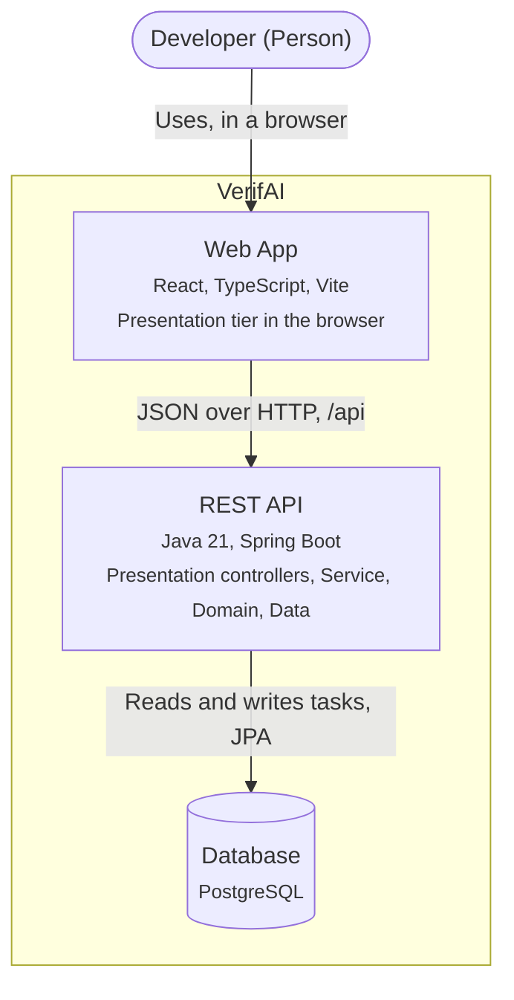
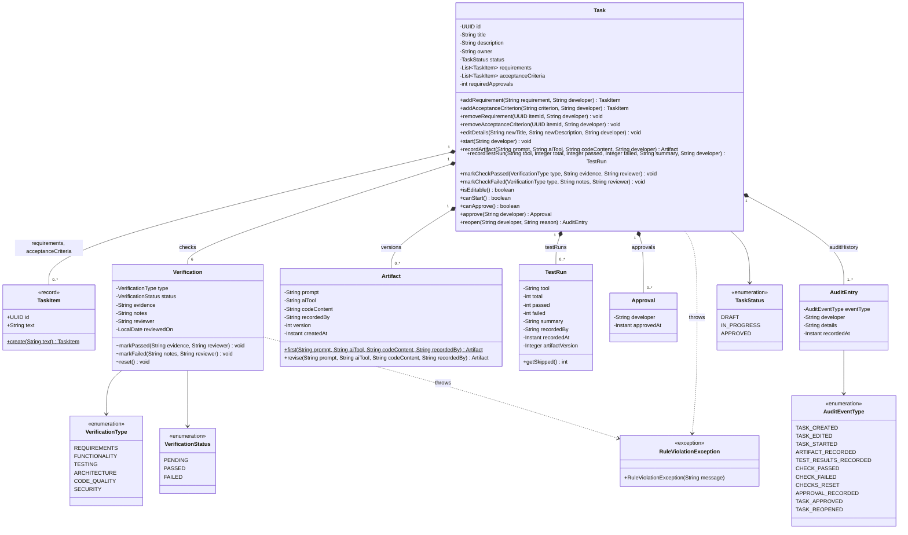
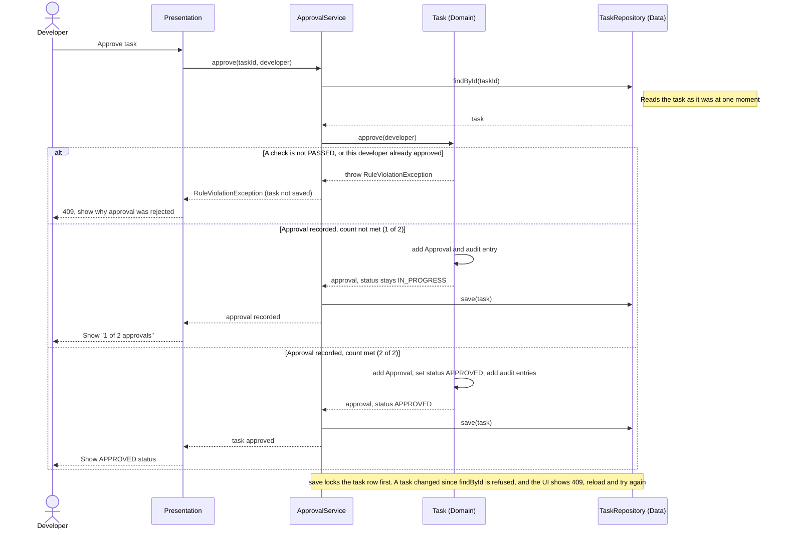

# VerifAI: AI Code Verification & Accountability Manager


**Student:** Alejandro Santana · **Course:** CEN 5064 Software Design, Fall 2026 · **Peer reviewer:** [@dquin144]

**Final design document:** [docs/design-document.md](docs/design-document.md) describes the system as built, including where SOLID principles and design patterns were applied and where I chose not to use one. How the midterm feedback was addressed is under [Feedback addressed](#feedback-addressed).

## Project Description

AI coding assistants allow developers to produce software faster, but they also create a growing need to verify that AI-generated code actually satisfies its requirements, passes appropriate tests, and fits the architecture of the project. VerifAI is a lightweight system designed for software developers who use AI coding assistants and want a structured way to verify and document their AI-assisted work before it is committed. The system will allow developers to define development tasks and acceptance criteria, record AI-generated code and its associated prompts, perform and track verification checks such as requirements, testing, architecture, and security reviews, and maintain an auditable history of verification results and human approval. The goal is to provide developers with a repeatable workflow for moving AI-generated code from generation → verification → correction → approval, while maintaining human accountability for the final implementation.

**Core Features**
- <ins>Task & Specification Management</ins>: Create development tasks with descriptions, requirements, and acceptance criteria that define what the implementation must accomplish.
- <ins>AI Artifact Tracking</ins>: Record AI-generated code, prompts, AI tools, and implementation versions associated with each development task.
- <ins>Verification & Testing</ins>: Track verification checks covering requirements, functionality, testing, architecture, code quality, and security, including the results of automated tests where applicable.
- <ins>Review & Accountability</ins>: Manage the approval workflow and maintain a history of verification results and revisions. A task cannot be approved unless every required verification check has been individually marked as **PASSED** and at least two different developers have approved it, ensuring that approval represents a completed verification process rather than simply a recorded status.

## How to run

### Requirements

Install each of these and make sure it is on your `PATH`:

- **Git:** [download](https://git-scm.com/downloads)
- **JDK 21:** [Oracle JDK 21 download](https://www.oracle.com/java/technologies/downloads/#java21). Any JDK 21 works.
- **Maven 3.9 or newer:** [download](https://maven.apache.org/download.cgi) and [install guide](https://maven.apache.org/install.html). There is no Maven wrapper, so Maven must be installed.
- **Node.js 24 (includes npm):** [download](https://nodejs.org/en/download). Used by the React frontend.
- **Docker with Docker Compose:** [Docker Desktop download](https://www.docker.com/products/docker-desktop/). Runs the PostgreSQL database. `mvn verify` does not need it; the tests use an in-memory H2 database.

Check them:

```
git --version
java -version
mvn -v
node -v
npm -v
docker compose version
```

`java -version` should report version 21, `mvn -v` should report Maven 3.9 or newer running on Java 21, `node -v` should start with `v24`, and `docker compose version` should print a version. Docker Desktop must be running.

### Build and run

The app has three parts: a PostgreSQL database in Docker, the backend API on port 8080, and the frontend dev server on port 5173. The frontend sends every `/api` request to the backend, and the backend stores every task in the database, so start all three.

**Terminal 1, the database and the backend.** Build, test, start the database, and start the backend from a fresh clone. These commands work in PowerShell and in bash:

```
git clone https://github.com/ASantana0924/cen5064-project-santana.git
cd cen5064-project-santana
mvn verify
docker compose up -d
mvn spring-boot:run "-Dspring-boot.run.profiles=demo"
```

- `mvn verify` should end with `BUILD SUCCESS` and `Failures: 0, Errors: 0`. It does not need Docker.
- `docker compose up -d` starts PostgreSQL 17 from `compose.yaml` in the background and should end with `Container cen5064-project-santana-postgres-1 Started`. The data is kept in the Docker volume `verifai-data`.
- `mvn spring-boot:run` keeps running and should log `Successfully applied 1 migration` on the first start (`Schema "public" is up to date` after that) and then `Tomcat started on port 8080`. Flyway creates the tables from `src/main/resources/db/migration`.
- The `demo` profile adds four sample tasks, one at each stage of the workflow, when the database has no tasks yet. Restarting with it keeps the tasks you already have. Keep the quotes; PowerShell needs them. To start without sample tasks, run `mvn spring-boot:run` instead.

The backend connects to `jdbc:postgresql://localhost:5432/verifai` as user `verifai` with password `verifai`, which matches `compose.yaml`. To use another database, set the environment variables `DB_URL`, `DB_USERNAME`, and `DB_PASSWORD` before starting it, for example `$env:DB_URL = "jdbc:postgresql://localhost:5433/verifai"` in PowerShell or `export DB_URL=jdbc:postgresql://localhost:5433/verifai` in bash. If port 5432 is already in use, change the left side of `"5432:5432"` in `compose.yaml` and set `DB_URL` to match.

**Terminal 2, the frontend.** Open a second terminal in the same `cen5064-project-santana` folder:

```
cd frontend
npm ci
npm run dev
```

- `npm ci` installs the exact versions in `package-lock.json`. It is needed only after a fresh clone or when `package-lock.json` changes.
- `npm run dev` keeps running and prints `Local: http://localhost:5173/`.

Open http://localhost:5173 in a browser. With the `demo` profile you should see four tasks: two Draft, one In progress, and one Approved. Choose your name with the button at the top right; it is saved in the browser, used as the owner of tasks you create, and recorded on every change. Select **New task** to create one, or select a task to see its details. On a Draft or In progress task you can select **Edit** to change the title and description, and add or remove requirements and acceptance criteria. **Start task** is enabled once a Draft task has at least one of each. On an In progress task, changing a requirement or criterion first asks you to confirm, because it sets every check back to Pending and clears the approvals. On an In progress task you can also select **Record artifact** in the Artifacts card to record the prompt, AI tool, and code of an AI-generated artifact. The first is version 1; recording another asks you to confirm, because a new version also resets every check and clears the approvals. The version history lists every version, newest first, and selecting one opens its prompt and code. Once a task has two versions, select **Compare versions** to pick any two (the two newest at first) and see what changed: the AI tool, the prompt word by word, and the code line by line, with removed lines marked − and added lines marked +. Picking the same version twice shows "No differences" ([ADR-011](docs/adr/adr-011.md)). The Checks card shows how many checks are passed, failed, and pending. On an In progress task each check has **Mark passed** and **Mark failed** buttons: passing opens a dialog that requires evidence, and failing opens a dialog that requires notes and lists the approvals it will clear. Under Testing, select **Record test run** to record a tool and its total, passed, and failed counts; the run is listed with its skipped count and artifact version, and the Testing check keeps its status. Once all six checks pass, select **Approve** in the Approvals card. It shows progress such as "1 of 2" and is disabled for a name that has already approved, so switch to another name for the second approval; the task then shows Approved. On an Approved task, **Reopen** at the top asks for a reason and returns the task to In progress with every check Pending and no approvals. The Audit history card at the bottom lists every change, newest first, including old approvals and the reopen reason. **Download report** at the top, on any task and without choosing a name, saves the task's whole verification record as a Markdown file ([ADR-012](docs/adr/adr-012.md)). Each change shows a notification, including the server's message when a rule blocks it.

Tasks, artifacts, checks, test runs, approvals, and audit history are stored in PostgreSQL, so they are still there after you restart the backend or the database. Press `Ctrl+C` in each terminal to stop the app, and run `docker compose stop` to stop the database. `docker compose down` removes the container but keeps the data; `docker compose down -v` also deletes the data, so the next start begins with an empty database.

To run the frontend checks that CI runs, from the `frontend` folder:

```
npm run lint
npm run build
npm test
```

Each should finish without errors, and `npm test` should report every test as passed.

### Try the API

You can also call the API directly. Open another PowerShell window while the backend is running. List the tasks:

```powershell
Invoke-RestMethod http://localhost:8080/api/tasks | Format-Table title, owner, status, passedChecks, approvalCount
```

With the `demo` profile you should see four rows: two DRAFT, one IN_PROGRESS with 3 passed checks, and one APPROVED with 2 approvals. Without it the list is empty.

Create a task, add a requirement and an acceptance criterion, and start it:

```powershell
$api = "http://localhost:8080/api/tasks"
$task = Invoke-RestMethod -Method Post -Uri $api -ContentType "application/json" -Body '{"title":"Add login check","description":"Reject blank usernames","developer":"alex"}'
Invoke-RestMethod -Method Post -Uri "$api/$($task.id)/requirements" -ContentType "application/json" -Body '{"text":"Blank usernames are rejected","developer":"alex"}' | Out-Null
Invoke-RestMethod -Method Post -Uri "$api/$($task.id)/acceptance-criteria" -ContentType "application/json" -Body '{"text":"A blank username shows an error","developer":"alex"}' | Out-Null
Invoke-RestMethod -Method Post -Uri "$api/$($task.id)/start" -ContentType "application/json" -Body '{"developer":"alex"}' | Select-Object title, status, canStart
```

The last command should print `status` as `IN_PROGRESS` and `canStart` as `False`.

Record the AI-generated code. The system assigns the version number:

```powershell
$artifact = '{"prompt":"Write a login check","aiTool":"Claude","codeContent":"boolean ok(String u) { return !u.isBlank(); }","developer":"alex"}'
Invoke-RestMethod -Method Post -Uri "$api/$($task.id)/artifacts" -ContentType "application/json" -Body $artifact | Select-Object version, recordedBy
```

This should print `version` as `1`. Recording another artifact would create version 2 and set all six checks back to PENDING.

Record the results of an automated test run, then look at the TESTING check:

```powershell
$run = '{"tool":"JUnit","total":14,"passed":12,"failed":1,"summary":"1 failure in LoginCheckTest","developer":"alex"}'
Invoke-RestMethod -Method Post -Uri "$api/$($task.id)/test-runs" -ContentType "application/json" -Body $run | Select-Object passed, failed, skipped, artifactVersion
(Invoke-RestMethod "$api/$($task.id)/checks").checks | Where-Object type -eq "TESTING" | Select-Object type, status
```

The first command should print `passed` 12, `failed` 1, `skipped` 1, and `artifactVersion` 1. The second should still show TESTING as `PENDING`: a test run is evidence for a reviewer and never changes a check ([ADR-006](docs/adr/adr-006.md)).

Mark all six checks PASSED with evidence, then look at the summary:

```powershell
foreach ($type in "REQUIREMENTS", "FUNCTIONALITY", "TESTING", "ARCHITECTURE", "CODE_QUALITY", "SECURITY") {
    $body = @{ evidence = "Reviewed $type"; reviewer = "dana" } | ConvertTo-Json
    Invoke-RestMethod -Method Post -Uri "$api/$($task.id)/checks/$type/pass" -ContentType "application/json" -Body $body | Out-Null
}
(Invoke-RestMethod "$api/$($task.id)/checks").summary
```

The summary should show `passed` 6, `failed` 0, and `pending` 0.

Two different developers approve:

```powershell
Invoke-RestMethod -Method Post -Uri "$api/$($task.id)/approvals" -ContentType "application/json" -Body '{"developer":"alex"}' | Select-Object progress, taskStatus
Invoke-RestMethod -Method Post -Uri "$api/$($task.id)/approvals" -ContentType "application/json" -Body '{"developer":"dana"}' | Select-Object progress, taskStatus
```

The first should print `1 of 2` and `IN_PROGRESS`, the second `2 of 2` and `APPROVED`. Running either again fails with 409, because the same developer cannot approve twice.

Reopen the task with a reason, then read its audit history:

```powershell
Invoke-RestMethod -Method Post -Uri "$api/$($task.id)/reopen" -ContentType "application/json" -Body '{"developer":"sam","reason":"Found a missed edge case"}' | Select-Object status
Invoke-RestMethod "$api/$($task.id)/audit" | Format-Table eventType, developer, details
```

The task is `IN_PROGRESS` again. The audit history lists every step oldest first, including a `TEST_RESULTS_RECORDED` entry for the test run, both approvals, and a `TASK_REOPENED` entry with the reason.

Download the task's verification report as a Markdown file and look at its first lines:

```powershell
Invoke-WebRequest "$api/$($task.id)/report" -OutFile report.md
Get-Content report.md -TotalCount 9
```

The file starts with `# Verification report: Add login check`, the time it was made in UTC, and a summary with the status, owner, approvals, and checks. Below that are sections for the description, requirements, acceptance criteria, checks with their evidence or notes, test runs, every artifact version with its prompt and code, approvals, and the audit history. Open it in any text editor or Markdown viewer.

Endpoints:

| Method | Path | Body or query | Does |
|---|---|---|---|
| POST | `/api/tasks` | `{title, description, developer}` | Creates a DRAFT task owned by `developer`. Returns 201 and a `Location` header. |
| GET | `/api/tasks` | | Lists task summaries, oldest first. |
| GET | `/api/tasks/{id}` | | Returns full details, including `requirements` and `acceptanceCriteria` as lists of `{id, text}`, the latest test run (`latestTestRun`, or null), and the `editable`, `canStart`, and `canApprove` flags. |
| PATCH | `/api/tasks/{id}` | `{title, description, developer}` | Edits the title and description. |
| POST | `/api/tasks/{id}/requirements` | `{text, developer}` | Adds a requirement with a new id. |
| DELETE | `/api/tasks/{id}/requirements/{requirementId}` | `?developer=alex` | Removes the requirement with that id ([ADR-009](docs/adr/adr-009.md)). |
| POST | `/api/tasks/{id}/acceptance-criteria` | `{text, developer}` | Adds an acceptance criterion with a new id. |
| DELETE | `/api/tasks/{id}/acceptance-criteria/{criterionId}` | `?developer=alex` | Removes the criterion with that id. |
| POST | `/api/tasks/{id}/start` | `{developer}` | Starts a DRAFT task. |
| POST | `/api/tasks/{id}/artifacts` | `{prompt, aiTool, codeContent, developer}` | Records the next artifact version on an IN_PROGRESS task. Returns 201 and a `Location` header. A new version resets all checks and clears approvals. |
| GET | `/api/tasks/{id}/artifacts` | | Lists artifact versions (version, AI tool, author, time), oldest first. |
| GET | `/api/tasks/{id}/artifacts/{version}` | | Returns one version with its prompt and code. |
| GET | `/api/tasks/{id}/checks` | | Returns the six checks and a `summary` of passed, failed, and pending counts. |
| POST | `/api/tasks/{id}/checks/{type}/pass` | `{evidence, reviewer}` | Marks the check PASSED. `type` is a check name such as `CODE_QUALITY`. |
| POST | `/api/tasks/{id}/checks/{type}/fail` | `{notes, reviewer}` | Marks the check FAILED and clears all approvals. |
| POST | `/api/tasks/{id}/test-runs` | `{tool, total, passed, failed, summary, developer}` | Records an automated test run on an IN_PROGRESS task against the current artifact version. `summary` is optional. Returns 201. Never changes a check. |
| GET | `/api/tasks/{id}/test-runs` | | Lists recorded test runs, newest first, with `skipped` (total minus passed minus failed) and `artifactVersion` (null if there was no artifact yet). |
| POST | `/api/tasks/{id}/approvals` | `{developer}` | Records an approval. Returns it with `progress` such as `"1 of 2"` and the task status. |
| POST | `/api/tasks/{id}/reopen` | `{developer, reason}` | Returns an APPROVED task to IN_PROGRESS and returns its details. |
| GET | `/api/tasks/{id}/audit` | | Lists the audit history, oldest first. |
| GET | `/api/tasks/{id}/report` | | Downloads the verification report as a Markdown file (`text/markdown`, with a `Content-Disposition` file name such as `verifai-report-add-login-check-2026-11-22.md`). Times in it are UTC ([ADR-012](docs/adr/adr-012.md)). |

Every action names the acting `developer`; there is no login ([ADR-005](docs/adr/adr-005.md)). Errors are JSON `{status, error, message}`: 400 for invalid input, such as a blank field, an unknown check type, or test run counts that are negative, add up to more than the total, or have a total of 0; 404 for an unknown task, artifact version, requirement, or acceptance criterion, such as removing a requirement someone else already removed; and 409 when a rule blocks the action, such as passing a check without evidence, failing one without notes, approving before all six checks pass, approving twice, or recording a test run on a task that is not IN_PROGRESS. A save is also refused with 409 when another request changed the task after it was loaded, such as in a second browser tab; reload the task and try again. The same happens when two people save one task at the same moment, for example both selecting **Approve**: the saves run one at a time, and the second gets the 409 instead of replacing the first ([ADR-010](docs/adr/adr-010.md)). Any other error is a bug: the backend logs it and returns 500 with the message `Unexpected server error` ([ADR-008](docs/adr/adr-008.md)).

Everything you create here is stored in PostgreSQL. To start over with an empty database, stop the backend and run `docker compose down -v`, then `docker compose up -d`.

## Rules

These rules live in the Domain tier and are recorded in [ADR-004](docs/adr/adr-004.md).

1. **Statuses.** A task is DRAFT, IN_PROGRESS, or APPROVED. A verification check is PENDING, PASSED, or FAILED.
2. **Six required checks.** Every task has one check of each type: REQUIREMENTS, FUNCTIONALITY, TESTING, ARCHITECTURE, CODE_QUALITY, SECURITY. All start as PENDING.
3. **Starting a task.** A DRAFT task can be started only when it has at least one requirement and at least one acceptance criterion. It then becomes IN_PROGRESS.
4. **Editing.** A task can be edited only while DRAFT or IN_PROGRESS. Editing the title or description never resets checks. An IN_PROGRESS task must keep at least one requirement and one acceptance criterion, so removing the last one is refused.
5. **Checks.** Checks can be marked only on an IN_PROGRESS task. Marking a check PASSED requires evidence. Marking it FAILED requires notes.
6. **Approval.** A task becomes APPROVED only when all six checks are PASSED and at least 2 different developers have approved it. The task owner may be one of them. The same developer cannot approve twice. Until the count is met, the task stays IN_PROGRESS and shows the count (for example "1 of 2 approvals"). The count is one app-wide setting, `verifai.approvals.required=2` in `application.properties`, applied when a task is created.
7. **Resets.** Any of the following sets all six checks back to PENDING and clears all approvals: recording a new artifact version, adding or removing a requirement or acceptance criterion on an IN_PROGRESS task, or reopening an approved task. Marking any check FAILED clears all approvals.
8. **Reopening.** An APPROVED task can be reopened with a required reason. It returns to IN_PROGRESS. The old approvals and the reason stay in the audit history.
9. **Audit history.** Every change to a task adds an audit entry. Entries are never edited or deleted.
10. **Identity.** There is no login. Each action names the developer who performed it ([ADR-005](docs/adr/adr-005.md)).
11. **Test runs.** The results of an automated test run (tool, total, passed, and failed counts, and an optional summary) can be recorded only on an IN_PROGRESS task. Counts cannot be negative, passed plus failed cannot be more than the total, and the total must be at least 1. Each run stores the current artifact version, or none if there is no artifact yet. A test run is evidence for the TESTING check and never changes any check or approval; a reviewer still marks TESTING PASSED or FAILED ([ADR-006](docs/adr/adr-006.md)).

## Architecture

### Tier breakdown

| Tier | Responsibilities in THIS system |
|------|--------------------------------|
| Presentation | A React single page app (`frontend/`) shows tasks, artifacts, checks and recorded test runs, approvals, and audit history, and sends user actions to Spring `@RestController` classes under `/api`. Controllers take and return DTOs, never Domain objects, and call only the Service tier. Neither part makes business decisions; the API returns domain-computed flags such as `canApprove` so the UI knows which buttons to enable. Components: `TaskController`, `ArtifactController`, `VerificationController`, `ApprovalController`, `ReportController` (with `VerificationReportMarkdown`) |
| Service | Receives requests from the Presentation tier, loads the task, calls the Domain to apply the change, and saves the result. Operations include creating and starting a task, recording an artifact, recording a test run, marking a check, approving, and reopening. `ReportService` only reads: it gathers a task's record into a `VerificationReport` and never saves. Components: `TaskService`, `ArtifactService`, `VerificationService`, `ApprovalService`, `ReportService` |
| Domain | Contains the core concepts, state, and every business rule in [Rules](#rules). `Task` is the aggregate root and the only way to change its requirements and acceptance criteria (each a `TaskItem` with its own id), checks, artifacts, test runs, approvals, and audit history. It enforces the approval rule: a task cannot become **APPROVED** unless all six required checks (REQUIREMENTS, FUNCTIONALITY, TESTING, ARCHITECTURE, CODE_QUALITY, SECURITY) are individually **PASSED** and 2 different developers have approved. A broken rule is reported with `RuleViolationException`, which the API returns as 409 ([ADR-008](docs/adr/adr-008.md)). Components: `Task`, `TaskItem`, `Verification`, `Artifact`, `TestRun`, `Approval`, `AuditEntry`, `RuleViolationException` |
| Data | Stores and loads whole tasks, including their requirements and acceptance criteria with their ids, checks, artifacts, test runs, approvals, and audit entries, in a single PostgreSQL database. It stores the state the Domain decided and does NOT decide whether a task can be approved. JPA entities and a mapper live here, so Domain classes have no JPA annotations, and Flyway owns the schema. Audit entries, artifacts, and test runs are only ever inserted. Saving locks the task's row, so two saves of one task run one at a time, and loading reads a task as it was at one moment ([ADR-010](docs/adr/adr-010.md)). Components: one `TaskRepository` interface ([ADR-003](docs/adr/adr-003.md)) implemented by `JpaTaskRepository` with `TaskMapper` ([ADR-007](docs/adr/adr-007.md)) |

### Current status

The diagrams below describe the system as built on `main`. The [design document](docs/design-document.md) adds a component diagram, a database diagram, a second sequence diagram, and the SOLID and pattern map.

- **Built:** all Domain classes and rules, the five Service classes, the `TaskRepository` interface stored in PostgreSQL with JPA and Flyway (tests use an in-memory H2 database with the same migration, so they do not need Docker), the REST API for tasks, artifacts, checks, recorded test runs, approvals, and audit history under `/api/tasks` with JSON errors and `demo` sample data, the React frontend with the task list, create task, and task details pages, editing a task and its requirements and acceptance criteria, starting a task, recording artifact versions, browsing their history, and comparing two of them, marking checks passed or failed and recording test runs, approving and reopening a task, the audit timeline, downloading a verification report as Markdown, and backend and frontend tests run by CI.
- **Not built yet:** nothing from the planned issues. All 18 use cases in scope (UC-01 to UC-18) are built, and none were cut. Follow-ups that were never in scope (cancelling a task, separating reviewers from approvers, login) are listed in the design document under [Known limitations and next steps](docs/design-document.md#13-known-limitations-and-next-steps).

### C4 — Context & Container

```mermaid
flowchart LR
    developer(["Developer<br/><small>&#40;Person&#41;</small>"])
    system["VerifAI<br/><small>&#40;Software System&#41;</small>"]

    developer -->|Defines tasks, records AI artifacts,<br/>marks checks, approves| system
    system -->|Shows check status, approval count,<br/>and audit history| developer
```



There is one kind of user. Task Owner (the developer who created a task) and Approver (a developer recording an approval) are roles a developer plays, not separate actors.



### UML — Class & Sequence



Each requirement and acceptance criterion is a `TaskItem` with its own id, made when it is added and never reused, so a removal names exactly one item ([ADR-009](docs/adr/adr-009.md)). Artifact versions are assigned by the system: the first artifact is version 1 and each revision adds 1. `Verification` methods and the `TestRun` constructor are package-private, so only `Task` can change a check or record a test run. A `TestRun` keeps the artifact version it ran against (null if there was none) and never changes a check.



## Feedback addressed

### Midterm check-in action item

> **Close scope and complete one use case end to end.**

At the midterm (commit `7ee1232`, Oct 12) the workflow ran in the Domain and Services but stopped at the API: there were no endpoints for checks or approvals, and the UI was read-only. I closed the scope to the issues already planned (#51 to #61, created Oct 12) and added no new use cases. Then I finished the first full path, **create → define → start → record artifact → pass six checks → two approvals → Approved → reopen**: the API in [#68](https://github.com/ASantana0924/cen5064-project-santana/pull/68), the UI in [#70](https://github.com/ASantana0924/cen5064-project-santana/pull/70), [#71](https://github.com/ASantana0924/cen5064-project-santana/pull/71), [#73](https://github.com/ASantana0924/cen5064-project-santana/pull/73), and [#74](https://github.com/ASantana0924/cen5064-project-santana/pull/74), and storage in PostgreSQL in [#75](https://github.com/ASantana0924/cen5064-project-santana/pull/75) so it survives a restart. `ApiWorkflowTest.taskGoesFromDraftToApprovedToReopenedWithFullAuditHistory` runs that path over HTTP. With it done, I closed every remaining planned issue ([#81](https://github.com/ASantana0924/cen5064-project-santana/pull/81) for UC-17 and [#82](https://github.com/ASantana0924/cen5064-project-santana/pull/82) for UC-18), so all 18 use cases in scope are delivered and nothing was cut.

### Peer reviews

| Review | Concern | Resolution |
|---|---|---|
| [#65](https://github.com/ASantana0924/cen5064-project-santana/issues/65) midterm | Every `IllegalStateException` became a 409, so a bug could look like a rule violation | [#76](https://github.com/ASantana0924/cen5064-project-santana/pull/76), [ADR-008](docs/adr/adr-008.md): the Domain throws `RuleViolationException`; anything unexpected is logged and returns 500 |
| [#66](https://github.com/ASantana0924/cen5064-project-santana/issues/66) midterm | Removing requirements by position removes the wrong item after someone else's removal | [#77](https://github.com/ASantana0924/cen5064-project-santana/pull/77), [ADR-009](docs/adr/adr-009.md): each item has an id and is removed by id |
| [#67](https://github.com/ASantana0924/cen5064-project-santana/issues/67) final | Checks and approval could not be done from the UI | [#68](https://github.com/ASantana0924/cen5064-project-santana/pull/68), [#70](https://github.com/ASantana0924/cen5064-project-santana/pull/70), [#71](https://github.com/ASantana0924/cen5064-project-santana/pull/71), [#73](https://github.com/ASantana0924/cen5064-project-santana/pull/73), [#74](https://github.com/ASantana0924/cen5064-project-santana/pull/74) |
| [#79](https://github.com/ASantana0924/cen5064-project-santana/issues/79) final | Two people approving at the same moment could get a 500 | [#80](https://github.com/ASantana0924/cen5064-project-santana/pull/80), [ADR-010](docs/adr/adr-010.md): saves lock the task row and loads read one snapshot |

Each review's interview question is answered in the pull request that fixed it.

## Architecture Decision Records

Decisions live in [`docs/adr/`](docs/adr/).

| # | Decision | Status |
|---|----------|--------|
| [001](docs/adr/adr-001.md) | Use Java 21 with Spring Boot for the technology stack | accepted, presentation part superseded by ADR-002 |
| [002](docs/adr/adr-002.md) | Use a React and TypeScript single page app over a JSON REST API | accepted |
| [003](docs/adr/adr-003.md) | Make `Task` the aggregate root with one `TaskRepository` | accepted |
| [004](docs/adr/adr-004.md) | Verification and approval rules | accepted |
| [005](docs/adr/adr-005.md) | Developer identity is supplied by the client, with no authentication | accepted |
| [006](docs/adr/adr-006.md) | Automated test runs are evidence, not verdicts | accepted |
| [007](docs/adr/adr-007.md) | Map the Task aggregate to JPA entities in the Data tier and rebuild it with `restore` factories | accepted, concurrent saves part superseded by ADR-010 |
| [008](docs/adr/adr-008.md) | Report rule violations with `RuleViolationException`, and map only it and stale saves to 409 | accepted |
| [009](docs/adr/adr-009.md) | Identify requirements and acceptance criteria by id, not by position | accepted |
| [010](docs/adr/adr-010.md) | Lock the task row while saving, and load each task from one snapshot | accepted |
| [011](docs/adr/adr-011.md) | Compute artifact diffs in the frontend with jsdiff | accepted |
| [012](docs/adr/adr-012.md) | Format the verification report as Markdown in the Presentation tier | accepted |

## Weekly log (optional but recommended)

A one-line note per week keeps your commit story readable:

- Week 1 (Aug 24): Repository created; brainstormed and evaluated potential project ideas based on personal interest, feasibility, and course scope.
- Week 2 (Aug 31): Project Approved. Defined four core features, established the Presentation → Service → Domain → Data architecture, and documented the approval constraint requiring all verification checks to pass before a task can be approved.
- Week 3 (Sep 7): Labor Day Recess
- Week 4 (Sep 14): Developed VerifAI's architectural and design models, including the C4 Context and Container diagrams and UML Class and Sequence diagrams. Refined the responsibilities of the Presentation, Service, Domain, and Data tiers, defined the relationships between Task, Verification, and Artifact, and documented the approval workflow requiring all verification checks to pass before approval. Created GitHub issues for the project's core use cases and implementation tasks.
- Week 5 (Sep 21): Created GitHub issues for VerifAI's core use cases and supporting development tasks. Organized the implementation plan around task management, AI artifact tracking, verification and testing, the approval workflow, layered architecture, database persistence, testing/CI, and the user interface.
- Week 6 (Sep 28): Chose Java 21 with Spring Boot (ADR-001), set up the Maven skeleton and CI, and added the task status and check type enums.
- Week 7 (Oct 5): Built the domain model and its rules (six checks, start rule, artifact versions with reset, approvals, reopen, audit history), the in-memory repository, the four services, and a temporary task list page.
- Week 8 (Oct 12): Midterm. Over the weekend of Oct 11 and 12, replaced the Thymeleaf page with a REST API and a React frontend (ADR-002), added ADR-003 to ADR-005, and updated the README. Midterm peer review #65. Wrote the remaining work as issues #51 to #61. The check-in action item was to close the scope and finish one use case end to end, so I added no use cases after this.
- Week 9 (Oct 19): No commits. Midterm exams and deadlines in other courses took priority. Midterm peer review #66 arrived and was added to the plan.
- Week 10 (Oct 26): No commits, for the same reason. The remaining work was already written up as issues #51 to #61, so I could pick it up without replanning.
- Week 11 (Nov 2): No commits. Other coursework and exams again. A rough three weeks, and the reason the next two weeks are dense.
- Week 12 (Nov 9): Final peer review #67. Added the REST API for artifacts, checks, approvals, and audit (#68), automated test runs as evidence (#69, ADR-006), and editing and starting in the UI (#70). Over the weekend I finished the end-to-end use case in the UI (artifacts #71, checks and test runs #73, approval, reopen, and audit #74), moved storage to PostgreSQL (#75, ADR-007), and fixed review #65 with `RuleViolationException` (#76, ADR-008).
- Week 13 (Nov 16): Fixed review #66 by removing items by id (#77, ADR-009) and a flaky ordering test (#78). Final peer review #79 led to the row lock and snapshot loads (#80, ADR-010). Built comparing artifact versions (#81, ADR-011) and the Markdown verification report (#82, ADR-012), which closed every planned issue. Wrote the final design document and prepared the slides and demo.