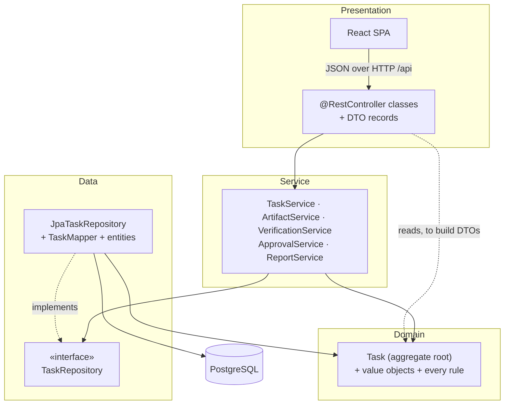
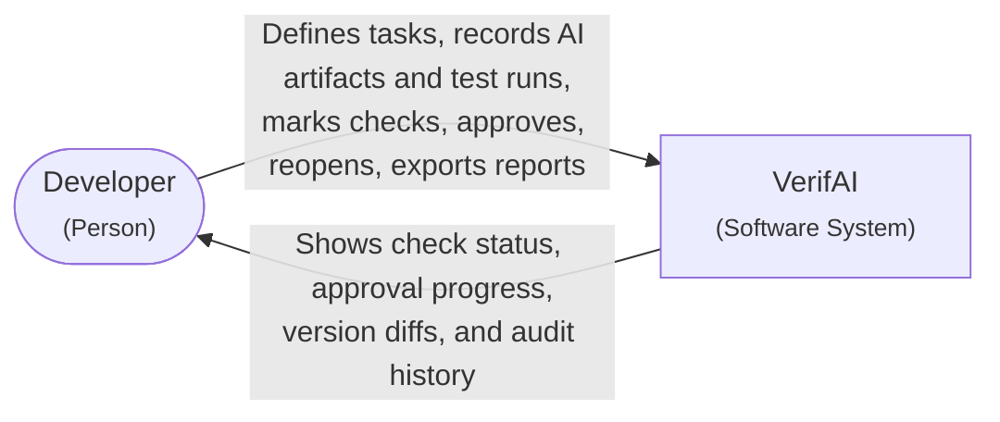
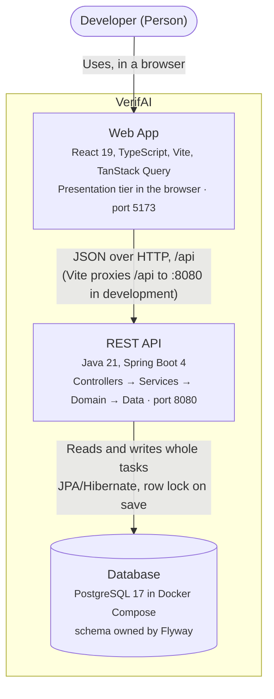
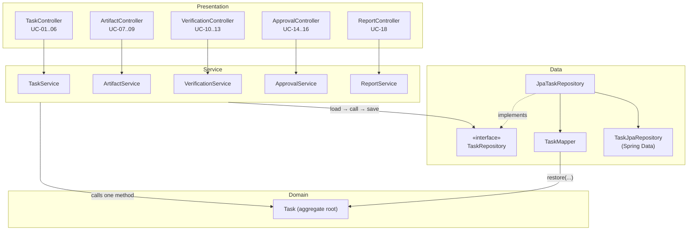
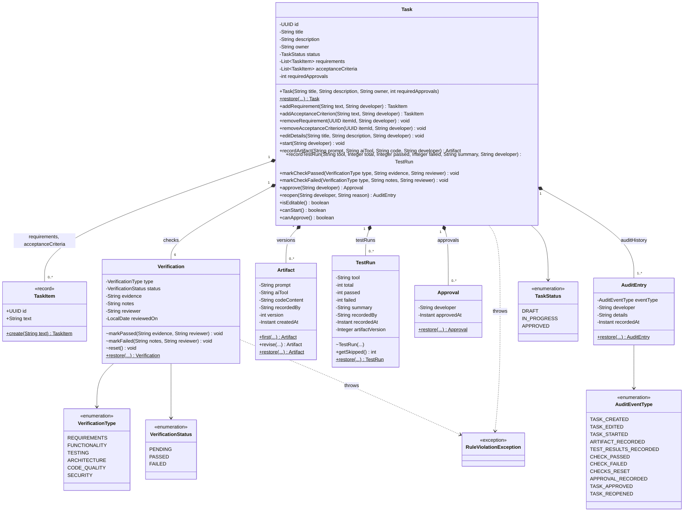
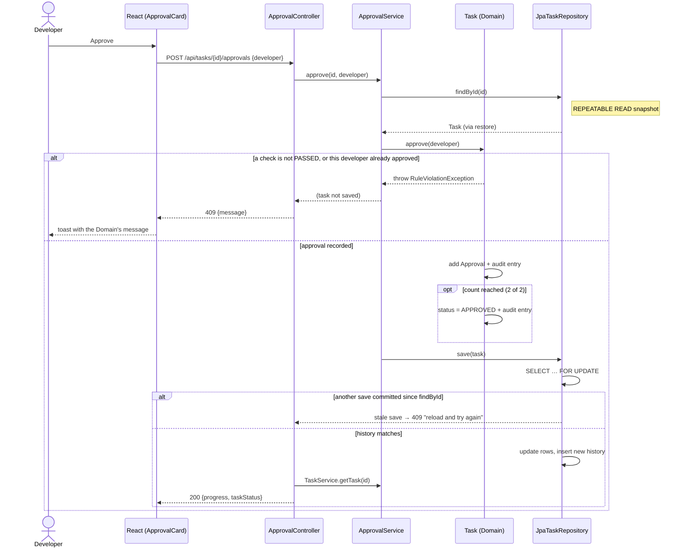
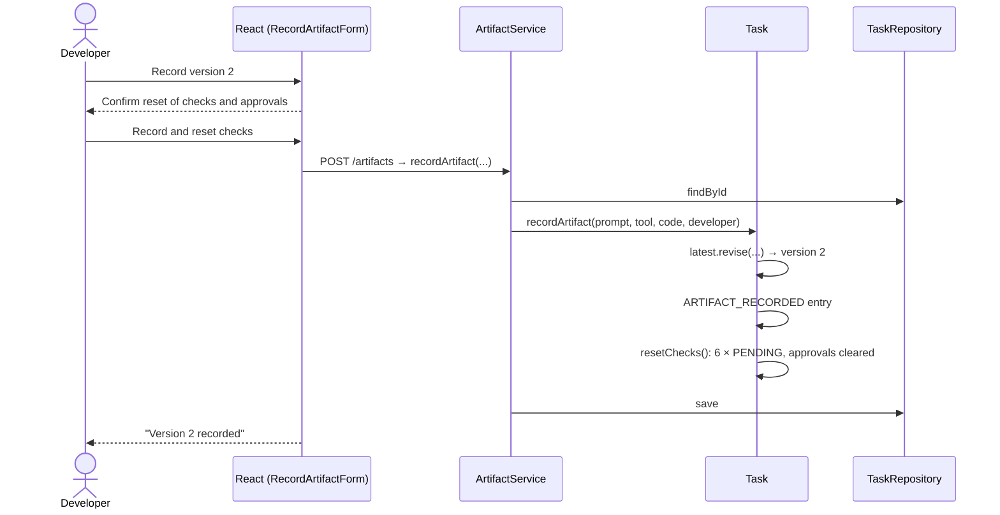
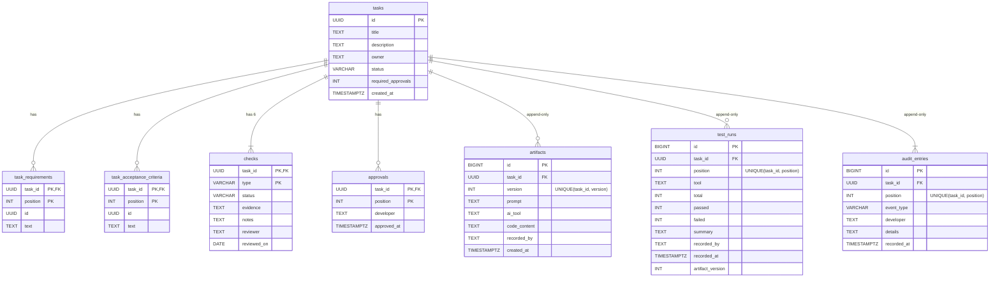

# VerifAI Design Document (final, as built)

**Student:** Alejandro Santana · **Course:** CEN 5064 Software Design, Fall 2026 · **Peer reviewer:** @dquin144\
**Repository:** https://github.com/ASantana0924/cen5064-project-santana\
**Describes:** the code on `main` at the final submission. The midterm baseline it is compared with is commit `7ee1232` (Oct 12), the commit both midterm peer reviews looked at.

This document describes the system as it was built, not as it was planned. Every class, file, and test it names exists in the repository. Where the design bends a principle or turns down a pattern, it says so and gives the reason.

## Contents

1. [Problem and scope](#1-problem-and-scope)
2. [Architecture](#2-architecture)
3. [Domain model and rules](#3-domain-model-and-rules)
4. [Key flows](#4-key-flows)
5. [Persistence](#5-persistence)
6. [Errors and the API contract](#6-errors-and-the-api-contract)
7. [Frontend](#7-frontend)
8. [SOLID principles: where they are applied, and where they bend](#8-solid-principles-where-they-are-applied-and-where-they-bend)
9. [Design pattern map](#9-design-pattern-map)
10. [What changed since the midterm](#10-what-changed-since-the-midterm)
11. [Feedback addressed](#11-feedback-addressed)
12. [Testing and CI](#12-testing-and-ci)
13. [Known limitations and next steps](#13-known-limitations-and-next-steps)

---

## 1. Problem and scope

AI coding assistants write code faster than people can check it. VerifAI gives a developer a repeatable path from *generated* to *verified* to *approved*, and keeps a record that shows who checked what. An approval in VerifAI means the verification really happened. A status field someone flipped does not count.

**Users.** One kind of user, the Developer. *Task owner* (the person who created a task), *reviewer* (the person who marks a check), and *approver* are roles a developer plays, not separate accounts ([ADR-005](adr/adr-005.md)).

**Core rule.** A task becomes APPROVED only when all six checks (Requirements, Functionality, Testing, Architecture, Code quality, Security) are PASSED, each with evidence, **and** two different developers have approved. Any change to the code or the requirements sends the task back through every check.

### Use cases: approved scope and delivery

All 18 use cases in the approved scope are built and reachable from the UI. No use case was cut. The four items that are not built (cancelling a task, separation of duties between reviewers and approvers, login, server-side diffs) were never in the approved scope. They came up later as reviewer interview questions or ADR follow-ups and are listed in [§13](#13-known-limitations-and-next-steps).

| UC | Use case | Service method | Endpoint | UI |
|---|---|---|---|---|
| UC-01 | Create a task | `TaskService.createTask` | `POST /api/tasks` | New task page |
| UC-02 | Add/remove acceptance criteria | `TaskService.addAcceptanceCriterion`, `removeAcceptanceCriterion` | `POST/DELETE .../acceptance-criteria` | Acceptance criteria card |
| UC-03 | Edit details, add/remove requirements | `TaskService.editDetails`, `addRequirement`, `removeRequirement` | `PATCH /api/tasks/{id}`, `POST/DELETE .../requirements` | Edit form, Requirements card |
| UC-04 | Start a task | `TaskService.startTask` | `POST .../start` | Start task button |
| UC-05 | List tasks | `TaskService.listTasks` | `GET /api/tasks` | Task list page |
| UC-06 | View a task | `TaskService.getTask` | `GET /api/tasks/{id}` | Task details page |
| UC-07 | Record an AI artifact | `ArtifactService.recordArtifact` | `POST .../artifacts` | Record artifact form |
| UC-08 | Record a revised artifact (resets checks) | `ArtifactService.recordArtifact` | `POST .../artifacts` | Record new version + confirm |
| UC-09 | Browse artifact versions | `ArtifactService.listVersions`, `getVersion` | `GET .../artifacts[/{version}]` | Version history, version page |
| UC-10 | Record automated test results | `VerificationService.recordTestRun`, `listTestRuns` | `POST/GET .../test-runs` | Record test run form |
| UC-11 | Mark a check passed (evidence) | `VerificationService.markPassed` | `POST .../checks/{type}/pass` | Mark passed dialog |
| UC-12 | Mark a check failed (notes) | `VerificationService.markFailed` | `POST .../checks/{type}/fail` | Mark failed dialog |
| UC-13 | View checks and summary | `VerificationService.listChecks` | `GET .../checks` | Checks card |
| UC-14 | Approve | `ApprovalService.approve` | `POST .../approvals` | Approvals card |
| UC-15 | Reopen with a reason | `ApprovalService.reopen` | `POST .../reopen` | Reopen dialog |
| UC-16 | View audit history | `ApprovalService.getAuditHistory` | `GET .../audit` | Audit history card |
| UC-17 | Compare two artifact versions | (frontend only, [ADR-011](adr/adr-011.md)) | uses `GET .../artifacts/{version}` | Compare versions page |
| UC-18 | Export a verification report | `ReportService.getReport` | `GET .../report` | Download report button |

---

## 2. Architecture

### 2.1 Tiers

VerifAI has four tiers. The backend is one Spring Boot application, one Java package per tier. The React app is the browser half of the Presentation tier.

| Tier | Package / folder | Responsibility | Classes |
|---|---|---|---|
| Presentation | `verifai.presentation`, `frontend/` | HTTP and UI only. Controllers turn requests into Service calls and Domain results into DTO records. The React app shows state and sends actions. Neither decides a rule. Task details carry Domain-computed flags (`editable`, `canStart`, `canApprove`) so the UI knows which buttons to enable. | `TaskController`, `ArtifactController`, `VerificationController`, `ApprovalController`, `ReportController`, `VerificationReportMarkdown`, `ApiExceptionHandler`, 22 request/response records |
| Service | `verifai.service` | One class per group of use cases. Each write is *load the task → call one `Task` method → save the task*. Reads load and return. | `TaskService`, `ArtifactService`, `VerificationService`, `ApprovalService`, `ReportService`, `VerificationReport` |
| Domain | `verifai.domain` | Every business rule. `Task` is the aggregate root and the only way to change anything inside a task. Plain Java: no Spring, JPA, or Jakarta imports. | `Task`, `TaskItem`, `Verification`, `Artifact`, `TestRun`, `Approval`, `AuditEntry`, `RuleViolationException`, 4 enums |
| Data | `verifai.data` | Saves and loads whole tasks in PostgreSQL. Stores what the Domain decided and decides nothing itself. JPA entities and the mapper live here, so the Domain stays free of persistence code. Flyway owns the schema. | `TaskRepository` (interface), `JpaTaskRepository`, `TaskJpaRepository`, `TaskMapper`, `TaskEntity` + 3 embeddables + 3 `@Immutable` entities, `InMemoryTaskRepository` (tests only) |

**Dependency direction (enforced by imports):**

The Domain imports nothing from the other tiers. Controllers read Domain objects only to copy them into DTOs (for example `TaskDetailsResponse.from(Task)`), and every change goes through a Service. Spring injects `JpaTaskRepository` wherever a Service asks for a `TaskRepository`.

### 2.2 C4 Level 1: System context

### 2.3 C4 Level 2: Containers

### 2.4 C4 Level 3: Components of the REST API

Each controller calls the service for its use cases. Two Presentation helpers are left out of the diagram to keep it readable: `ApiExceptionHandler`, which turns every exception from any controller into a JSON error (§6), and `VerificationReportMarkdown`, which `ReportController` uses to format the report. `VerificationController` and `ApprovalController` also call `TaskService.getTask` so they can return the updated task (approval count, new status) after a change. Every service depends on the `TaskRepository` interface and on `Task`, and nothing else.

---

## 3. Domain model and rules

### 3.1 Class diagram (matches `verifai.domain`)

`~` marks package-private members. `Verification.markPassed/markFailed/reset` and the `TestRun` constructor are package-private, so code outside `verifai.domain` cannot change a check or create a test run except through `Task`. Getters return copies (`List.copyOf`), so a caller cannot change a task's lists either. The public `restore(...)` factories exist only for `TaskMapper` ([ADR-007](adr/adr-007.md)).

### 3.2 Rules and where each one is enforced

Each rule lives in one Domain method, so no path through the API or UI can skip it. A broken rule throws `RuleViolationException`, and the API returns it as 409.

| # | Rule | Enforced in | Example tests |
|---|---|---|---|
| 1 | Six required checks, all start PENDING | `Task` constructor loops over `VerificationType.values()` | `TaskTest.newTaskHasOneCheckPerTypeInEnumOrder` |
| 2 | Start needs ≥1 requirement and ≥1 acceptance criterion | `Task.start`, `Task.canStart` | `startWithoutRequirementIsRejected`, `startWithoutAcceptanceCriterionIsRejected` |
| 3 | Only DRAFT/IN_PROGRESS can be edited; an IN_PROGRESS task keeps ≥1 of each list | `Task.requireEditable`, `Task.removeItem` | `editingAnApprovedTaskIsRejected`, `TaskControllerTest.removingTheLastRequirementOfAnInProgressTaskReturns409` |
| 4 | Pass needs evidence; fail needs notes; only on IN_PROGRESS | `Verification.markPassed/markFailed`, `Task.markCheckPassed/Failed` | `VerificationTest.passWithoutEvidenceIsRejected`, `failWithoutNotesIsRejected` |
| 5 | Approve only when all six PASSED; same developer cannot approve twice; APPROVED at the configured count | `Task.approve`, `Task.canApprove` | `approveIsRejectedWhileAnyCheckIsPending`, `duplicateApprovalBySameDeveloperIsRejected`, `secondDeveloperApprovalApprovesTask` |
| 6 | New artifact version, requirement/criterion change on IN_PROGRESS, or reopen → all checks PENDING, approvals cleared | `Task.resetChecks`, `resetChecksIfInProgress` | `newArtifactVersionResetsAllChecksToPending`, `addingRequirementOnInProgressTaskResetsChecksAndClearsApprovals` |
| 7 | Failing a check clears approvals | `Task.markCheckFailed` | `failingACheckSetsItFailedAndClearsApprovals` |
| 8 | Reopen only an APPROVED task, with a reason; old approvals stay in history | `Task.reopen` | `reopenRecordsReasonAndOldApprovalsInAuditHistory`, `reopenWithoutReasonIsRejected` |
| 9 | Every change adds an audit entry; entries are never edited or deleted | `Task.addAuditEntry` (private); `@Immutable` entities in Data | `rejectedActionsAddNoAuditEntries`, `JpaTaskRepositoryTest.auditArtifactAndTestRunRowsAreOnlyEverInserted` |
| 10 | A test run is evidence only: counts valid, IN_PROGRESS only, never changes a check | `TestRun` constructor, `Task.recordTestRun` | `TestRunTest.passedPlusFailedMoreThanTotalIsRejected`, `ApiWorkflowTest.testRunsAreRecordedAsEvidenceWithoutChangingTheTestingCheck` |
| 11 | Artifact versions are assigned by the system (1, 2, 3, …) | `Artifact.first`, `Artifact.revise` | `laterArtifactsGetTheNextVersionInOrder` |

---

## 4. Key flows

### 4.1 Approve a task (UC-14), including the refusal path

### 4.2 Recording a new artifact version resets verification (UC-08)

---

## 5. Persistence

Tasks are stored in PostgreSQL 17 (Docker Compose). The schema comes from two Flyway migrations, `V1__init.sql` and `V2__task_item_ids.sql`. Hibernate runs with `ddl-auto=validate`, so it checks the schema and never changes it. Tests run the same migrations on H2 in PostgreSQL mode, so `mvn verify` needs no Docker.

**How a save works** (`JpaTaskRepository.save` → `TaskMapper.copyToEntity`):

1. **Lock.** `TaskJpaRepository.findForUpdateById` loads the stored row with a pessimistic write lock, so two saves of one task run one at a time ([ADR-010](adr/adr-010.md)).
2. **Check for a lost update.** `TaskMapper.requireSameHistory` checks that the stored audit history is the start of the task's history. If it is not, another request saved the task after this one loaded it, and the save is refused with `OptimisticLockingFailureException`, which the API returns as 409.
3. **Copy.** Changeable parts (title, status, lists, checks, approvals) are replaced in place, so Hibernate updates only the rows that changed. Artifacts, test runs, and audit entries are `@Immutable`. Only the ones past the stored count are inserted, so those tables never see an UPDATE or DELETE.

**How a load works.** `findById` and `findAll` run at REPEATABLE READ, so a load sees a single moment even if a save commits partway through. `TaskMapper.toDomain` rebuilds the aggregate with the `restore` factories, which run no rule and add no audit entry ([ADR-007](adr/adr-007.md)).

---

## 6. Errors and the API contract

`ApiExceptionHandler` is the only place that turns exceptions into HTTP status codes. Errors are JSON in the form `{status, error, message}`.

| Thrown | Meaning | HTTP |
|---|---|---|
| `IllegalArgumentException` | Invalid input (blank field, bad counts) | 400 |
| `HttpMessageNotReadableException`, `MethodArgumentTypeMismatchException` | Missing or bad body, path, or enum value | 400 |
| `NoSuchElementException` | Unknown task, artifact version, requirement, or criterion | 404 |
| `RuleViolationException` | A Domain rule blocked the action | 409 |
| `OptimisticLockingFailureException` | Another request changed the task first | 409 |
| Anything else | A bug: logged, details hidden | 500 `Unexpected server error` |

Before the midterm feedback, every `IllegalStateException` became a 409, so a real bug could pass for a rule violation. [ADR-008](adr/adr-008.md) gave rule violations their own exception type. The full endpoint table is in the README under [Try the API](../README.md#try-the-api).

---

## 7. Frontend

| Area | Files | Role |
|---|---|---|
| Routing | `src/routes.tsx` | `/`, `/tasks/new`, `/tasks/:id`, `/tasks/:id/artifacts/:version`, `/tasks/:id/artifacts/compare`. The create, version, and compare pages are lazy-loaded. |
| API layer | `src/api/client.ts`, `tasks.ts`, `artifacts.ts`, `verification.ts`, `approvals.ts`, `reports.ts`, `types.ts` | One module per backend controller. `client.ts` turns every failure into an `ApiError` carrying the server's message. `useTaskAction`/`useTaskRecordAction` in `tasks.ts` are the shared mutation hooks: they refresh the task and its audit history after each change. |
| Pages | `src/pages/*Page.tsx` | Task list, create, details, artifact version, compare. |
| Feature components | `src/components/{task,artifact,check,approval,audit}/` | One folder per card on the details page. |
| Identity | `src/lib/developer.ts`, `useDeveloper.ts`, `ActingAsPicker.tsx` | The "Acting as" name, saved in `localStorage` and sent as `developer` on every action ([ADR-005](adr/adr-005.md)). |
| Diffs | `src/lib/diff.ts`, `components/artifact/CodeDiff.tsx`, `TextDiff.tsx` | Line diff for code and word diff for prompts, using jsdiff ([ADR-011](adr/adr-011.md)). |

**Where the rules live, and the UI exception.** The UI enables buttons from the server's flags (`canStart`, `canApprove`, `editable`) and shows the server's 409 message when a rule blocks an action. It also has a few **usability guards** that repeat a Domain rule so the user gets told before sending a request: required evidence, notes, and reason fields (Zod schemas in `CheckReviewDialog.tsx` and `ReopenDialog.tsx`), and disabling Approve for someone who already approved (`ApprovalCard.tsx`, `hasApproved`). Each one has a comment saying the backend is the authority. If a guard is removed or wrong, the request still reaches the Domain and is refused. One example is removing the last acceptance criterion of an In-progress task: the UI allows the click, and the server refuses it. This is the refusal shown in the demo video.

---

## 8. SOLID principles: where they are applied, and where they bend

### S: Single Responsibility

| Applied | Where |
|---|---|
| One Service per group of use cases, so each changes for one reason | `TaskService` (UC-01–06), `ArtifactService` (UC-07–09), `VerificationService` (UC-10–13), `ApprovalService` (UC-14–16), `ReportService` (UC-18) |
| Converting between Domain and storage is one class's only job | `verifai.data.TaskMapper` |
| Formatting a report is separate from gathering it | `ReportService` gathers a `VerificationReport`; `presentation.VerificationReportMarkdown` formats it; `ReportController` only handles HTTP ([ADR-012](adr/adr-012.md)) |
| Mapping errors to HTTP is in one place | `presentation.ApiExceptionHandler` |
| Locking and isolation are separate from mapping | `JpaTaskRepository` (transactions, lock) vs. `TaskMapper` (fields) |

**Where it bends.** `Task` is the largest class (about 400 lines) and holds every workflow rule. That is on purpose ([ADR-003](adr/adr-003.md)): its one responsibility is keeping a task consistent, and splitting the reset, approval, and audit rules across classes would let a caller change part of a task without the rest. Status, check, and event labels are also written out twice, in `VerificationReportMarkdown` and in `frontend/src/lib/labels.ts`, so a new enum value has to be added in both places. ADR-012 records that trade-off.

### O: Open/Closed

| Applied | Where |
|---|---|
| Swapping storage changed no Service or Presentation code. #75 replaced the in-memory store with PostgreSQL behind the same interface. | `data.TaskRepository` ← `InMemoryTaskRepository`, `JpaTaskRepository` |
| A new check type needs no change to `Task` logic: the constructor builds one check per enum constant, and `canApprove` checks them all | `Task` constructor loops over `VerificationType.values()` |
| A new error type needs one handler method and no change to the controllers | `ApiExceptionHandler` |

**Where it bends.** A new check type still needs a label in two places, and the six-check rule is shown to users in the UI text. The approval policy (count, distinct approvers) is written directly in `Task.approve` rather than plugged in as a strategy. That is deliberate: there is one policy, it is set by `verifai.approvals.required`, and a pluggable policy would be speculative. See *Strategy* in §9.

### L: Liskov Substitution

| Applied | Where |
|---|---|
| Both repositories meet the `TaskRepository` contract (save returns the task, `findById` is empty for an unknown id, `findAll` is oldest first). Service tests run on the in-memory one; the app runs on the JPA one. | `InMemoryTaskRepositoryTest`, `JpaTaskRepositoryTest`, all `*ServiceTest` |
| `RuleViolationException` deliberately does **not** extend `IllegalStateException`. As a subtype, any `catch (IllegalStateException)` would also catch rule violations, which is the confusion the midterm review pointed out. | `domain.RuleViolationException`, [ADR-008](adr/adr-008.md) |

**Where it bends.** The two repositories do not behave the same under concurrency. `JpaTaskRepository` refuses a stale save (409) and serializes saves of one task. `InMemoryTaskRepository` returns the same object it stored and never refuses a save. The interface's contract covers storage, not concurrency, which is why the in-memory version is test-only and `TaskService` saves after every change (its Javadoc explains this). Concurrency is tested against the real repository (`ConcurrentSaveTest`, `StaleSaveTest`).

### I: Interface Segregation

| Applied | Where |
|---|---|
| The repository interface has only the three operations services need | `TaskRepository`: `save`, `findById`, `findAll` |
| The report formatter gets a read-only record, not the `Task`, so it cannot call a method that changes state | `service.VerificationReport` (copies of values and lists) |
| Each controller depends only on the services for its use cases | e.g. `ReportController` → `ReportService` only |
| UI components take narrow props (`task`, `developer`, `busy`) instead of global state | `ApprovalCard`, `ChecksCard`, `ArtifactsCard` |

**Where it bends.** `ReportService` only reads, but it gets the full `TaskRepository`, including `save`. Splitting the interface into a reader and a writer for three methods would add a type without making anything safer, so I left it as one.

### D: Dependency Inversion

| Applied | Where |
|---|---|
| Services depend on the `TaskRepository` abstraction, injected through the constructor; Spring picks `JpaTaskRepository` | every `*Service` constructor |
| Time is injected where output must be testable | `App.clock()` bean → `ReportService(TaskRepository, Clock)` |
| The Domain depends on nothing outside the JDK: no Spring, JPA, or Jakarta imports | `verifai.domain.*` (checked in peer review #79) |
| The approval count comes from configuration, not a constant in the service | `TaskService(@Value("${verifai.approvals.required:2}"))` |

**Where it bends.** (1) `TaskRepository` lives in `verifai.data`, so the Service package imports the Data package. In a strict ports-and-adapters layout, the higher-level package would own the interface. I kept it with its implementations because there is one consumer tier and moving it would only change an import path. (2) Domain timestamps use `Instant.now()` and `LocalDate.now()` directly instead of an injected `Clock`. Tests assert ordering and precision, not exact times, so I did not add a clock parameter to every Domain method.

---

## 9. Design pattern map

### Applied

| Pattern | Where | Why it fits |
|---|---|---|
| **Layered architecture** | `presentation` → `service` → `domain`, with `data` behind an interface | The course's four tiers; the dependency direction is shown in §2.1 |
| **Aggregate root** (DDD) | `domain.Task` | Rules span checks, artifacts, approvals, and audit; one entry point keeps every change consistent ([ADR-003](adr/adr-003.md)) |
| **Repository** | `data.TaskRepository`, `JpaTaskRepository` | Services see a collection of tasks, not SQL |
| **Adapter** | `JpaTaskRepository` adapts Spring Data's `TaskJpaRepository` (entities) to the Domain-facing `TaskRepository` (tasks) | Keeps Spring Data and entities out of the Service tier |
| **Data Mapper** | `data.TaskMapper` with `TaskEntity` and embeddables | The Domain has no JPA annotations; the mapper converts both ways ([ADR-007](adr/adr-007.md)) |
| **Service Layer** | `verifai.service.*` | A thin load → call → save script per use case; no rules |
| **Static factory methods** | `Artifact.first` / `revise`, `TaskItem.create`, each `restore(...)`, DTO `from(...)` methods | Named constructors make intent clear. `revise` assigns the next version; `restore` rebuilds without running rules. |
| **Value objects** | `TaskItem` (record), `Artifact`, `Approval`, `AuditEntry`, `TestRun` (all final fields) | Immutable, so history cannot change after it is recorded |
| **Data Transfer Object** | the 22 request/response records in `presentation` | The API never exposes Domain objects (`TaskControllerTest.responseDoesNotExposeDomainOnlyFields`) |
| **Dependency injection** | Spring constructor injection in every service and controller; the `Clock` bean | Wiring stays out of the classes |
| **Optimistic Offline Lock** (variant) | `TaskMapper.requireSameHistory`: the append-only audit history acts as the version | Catches a lost update across separate load and save transactions |
| **Pessimistic lock** | `TaskJpaRepository.findForUpdateById` (`@Lock(PESSIMISTIC_WRITE)`) | Two simultaneous saves wait instead of racing ([ADR-010](adr/adr-010.md)) |
| **Centralized exception translation** | `@RestControllerAdvice ApiExceptionHandler` | One place maps exceptions to status codes ([ADR-008](adr/adr-008.md)) |

### Considered and rejected ("no fit")

| Pattern | Where it was considered | Why it was not used |
|---|---|---|
| **State** | `TaskStatus` transitions (DRAFT → IN_PROGRESS → APPROVED → IN_PROGRESS) | Three states and three transitions (start, approve, reopen). A guard at the top of each `Task` method (`requireEditable`, `status != IN_PROGRESS`) is short and easy to read. State classes would spread the reset and audit logic across four files and make `restore` harder. I would revisit this if CANCELLED or ARCHIVED were added. |
| **Strategy** | The approval policy (count, distinct approvers), or "test runs decide TESTING" | There is one policy, set by `verifai.approvals.required`. A pluggable policy is speculative. Auto-deciding TESTING from counts was rejected on its merits ([ADR-006](adr/adr-006.md)), so there is nothing to plug in. |
| **Observer / domain events** | Writing an audit entry for each change | The audit entry is written inside the same `Task` method as the change, so they cannot drift apart or be lost between a publish and a handler. Events would add indirection with no second subscriber. |
| **Event Sourcing** | The audit history looks like an event log | The audit history is a record for people, not the source of truth. State is stored directly and loaded with `restore`. Rebuilding state from events would require every event to carry its full data, plus replay code. |
| **Builder** | `Task.restore(...)` takes 13 parameters | Only `TaskMapper` calls it, and the round-trip tests compare every field, so a swapped argument fails a test. A builder would add a class to protect a single call site. This is the weakest of the no-fit calls; I would add one if a second caller appeared. |
| **Command** | Wrapping each action (approve, reopen, …) as an object | There is no undo, queueing, or replay. Reopen is a new forward action with a reason, never an undo. Plain methods are enough. |
| **Singleton** (hand-written) | Shared services and configuration | Spring beans are already single instances managed by the container. A static singleton would block constructor injection and test doubles. |
| **Abstract Factory** | Creating storage implementations | There is one product (a `TaskRepository`), and Spring wiring already chooses it. |
| **Server-side diff service** | UC-17 compare | The diff is a display concern, and the client already has both versions. Moving it to the server would add an endpoint and DTOs for no gain ([ADR-011](adr/adr-011.md)). |

---

## 10. What changed since the midterm

The midterm baseline (`7ee1232`, Oct 12) had the full Domain, four services, an **in-memory** repository, the task REST API, and a React scaffold with three read-only pages. The whole check-and-approve workflow could not be done from the UI (raised in peer review #67). Everything below was added after the midterm through pull requests:

| Change | PR | ADR | Effect on the design |
|---|---|---|---|
| REST API for artifacts, checks, approvals, audit | #68 | — | Added `ArtifactController`, `VerificationController`, `ApprovalController` |
| Automated test runs as evidence (UC-10) | #69 | [006](adr/adr-006.md) | New `TestRun` value object and `TEST_RESULTS_RECORDED` event |
| UI: edit and start | #70 | — | Edit form, editable lists, Start button |
| UI: artifacts and version history | #71 | — | Artifacts card, version page |
| UI: checks and test runs | #73 | — | Checks card, review dialogs, test run form |
| UI: approve, reopen, audit timeline | #74 | — | Approvals card, Reopen dialog, Audit card. **Closes the end-to-end use case.** |
| PostgreSQL with JPA and Flyway | #75 | [007](adr/adr-007.md) | `JpaTaskRepository`, `TaskMapper`, entities, `restore` factories; in-memory store kept for tests |
| `RuleViolationException` | #76 | [008](adr/adr-008.md) | Midterm review #65 |
| Requirements/criteria by id | #77 | [009](adr/adr-009.md) | New `TaskItem` record, migration V2. Midterm review #66 |
| Flaky ordering test fixed | #78 | — | Test only |
| Row lock + snapshot loads | #80 | [010](adr/adr-010.md) | Final review #79 |
| Compare artifact versions (UC-17) | #81 | [011](adr/adr-011.md) | Compare page, `diff.ts` |
| Export verification report (UC-18) | #82 | [012](adr/adr-012.md) | `ReportService`, `VerificationReport`, `ReportController`, `VerificationReportMarkdown`, `Clock` bean |

**Diagram changes compared with the midterm README:** the Service tier now has five classes (`ReportService` added). The Domain gained `TaskItem`, `TestRun`, and `RuleViolationException`. The Data tier is now `JpaTaskRepository` + `TaskMapper` + entities rather than just an interface. The sequence diagram shows the row lock and the stale-save 409. The C4 container diagram now names the Vite proxy, Flyway, and the lock.

---

## 11. Feedback addressed

### Instructor check-in action item

> **Close scope and complete one use case end to end.**

**Resolution.** At the midterm, the core workflow ran in the Domain and Services but stopped at the API: no endpoints for checks or approvals and a read-only UI. The scope was then closed to the issues already planned (#51–#61, created Oct 12), with no new use cases added. The first complete end-to-end path, *create → define → start → record artifact → verify six checks → two approvals → APPROVED → reopen*, was finished in this order: API in **#68**, UI in **#70**, **#71**, **#73**, and **#74**, and persistence in **#75** so it survives a restart. It is exercised by `ApiWorkflowTest.taskGoesFromDraftToApprovedToReopenedWithFullAuditHistory` and shown in the demo video. After that, every remaining planned issue was closed (UC-17 in #81, UC-18 in #82), so all 18 use cases in scope are delivered and nothing was quietly cut.

### Peer reviews (dquin144)

| Review | Concern | Resolution |
|---|---|---|
| #65 (midterm, Oct 12) | Every `IllegalStateException` became a 409, so bugs could look like rule violations | PR #76, [ADR-008](adr/adr-008.md): `RuleViolationException`; anything else returns 500 and is logged. Also found and fixed a stale save that came back as 500 instead of 409. |
| #66 (midterm, Oct 19) | Deleting requirements by position removes the wrong item after a concurrent delete | PR #77, [ADR-009](adr/adr-009.md): `TaskItem` with a UUID; `DELETE …/{requirementId}`; migration V2 |
| #67 (final, Nov 9) | The check and approve workflow could not be done from the UI | PRs #68, #70, #71, #73, #74 |
| #79 (final, Nov 16) | Two simultaneous approvals could produce a 500 | PR #80, [ADR-010](adr/adr-010.md): row lock on save, REPEATABLE READ on load; `ConcurrentSaveTest.twoApprovalsAtTheSameMomentNeverFailWith500` |

Each review's interview question is answered in writing in the PR that fixed that review: cancelling a task (#76), whether a reviewer may also approve (#77), simultaneous approvals (#80, ADR-010), and why test runs do not decide TESTING (ADR-006).

---

## 12. Testing and CI

| Suite | Count | What it covers |
|---|---|---|
| Domain unit tests (`domain/*Test`) | 184 | Every rule in §3.2, including the unhappy paths (blank input, wrong state, duplicate approver, counts that do not add up, removing the last item) |
| Service tests (`service/*Test`) | 58 | Load → call → save, 404 for unknown ids, against `InMemoryTaskRepository` |
| Controller and report tests (`presentation/*Test`) | 92 | Status codes, JSON errors, the 500 path, DTO shape, Markdown escaping |
| Persistence tests (`data/*Test`, `RestartTest`) | 30 | Full round trip equal in every field, insert-only history, the migration from V1 to V2, data surviving a restart |
| Concurrency (`ConcurrentSaveTest`, `StaleSaveTest`) | 5 | Both ADR-010 races, and a stale save returning 409 |
| End-to-end over HTTP (`ApiWorkflowTest`) | 3 | Draft → approved → reopened with full audit; test runs; concurrent removals by id |
| Startup and demo data (`AppTests`, `DemoDataTest`) | 3 | The context starts; the `demo` profile seeds four tasks through the services |
| **Backend total** | **375** | `mvn verify` (H2, no Docker) |
| Frontend (`vitest`, Testing Library) | **183** in 23 files | Pages, dialogs, diff rendering, API client, identity |

GitHub Actions (`.github/workflows/ci.yml`) runs two jobs on every push and PR to `main`: `mvn -B verify`, and frontend `npm ci` → `lint` → `build` → `test`. CI is green on the final commit.

---

## 13. Known limitations and next steps

| Limitation | Why it is acceptable now | Next step |
|---|---|---|
| No authentication; anyone can act as anyone ([ADR-005](adr/adr-005.md)) | A single-team course demo; the audit still names everyone | Spring Security; replace the `developer` field with the logged-in user in the Presentation tier only |
| A reviewer may also be one of the two approvers | The two-approver rule still stops one person approving alone | Require at least one approver who passed no check (designed in the #77 answer) |
| Tasks cannot be cancelled | Deleting would break the append-only audit rule | Add a CANCELLED status with a reason and a `TASK_CANCELLED` entry (designed in the #76 answer) |
| 400 and 404 use JDK exceptions | Only 409 was ambiguous in practice | `InvalidInputException` and `TaskNotFoundException` (ADR-008 follow-up) |
| Labels are written in two places (report and UI) | Few values, and changes are rare | Serve labels from the API, or generate them |
| Whole artifacts are kept and diffed in full | Artifacts are hundreds of lines, not thousands | Collapse unchanged runs; diff in a web worker |
| No database trigger enforces append-only rows | `@Immutable` entities and tests enforce it | PostgreSQL trigger blocking UPDATE and DELETE on history tables (ADR-007 follow-up) |
